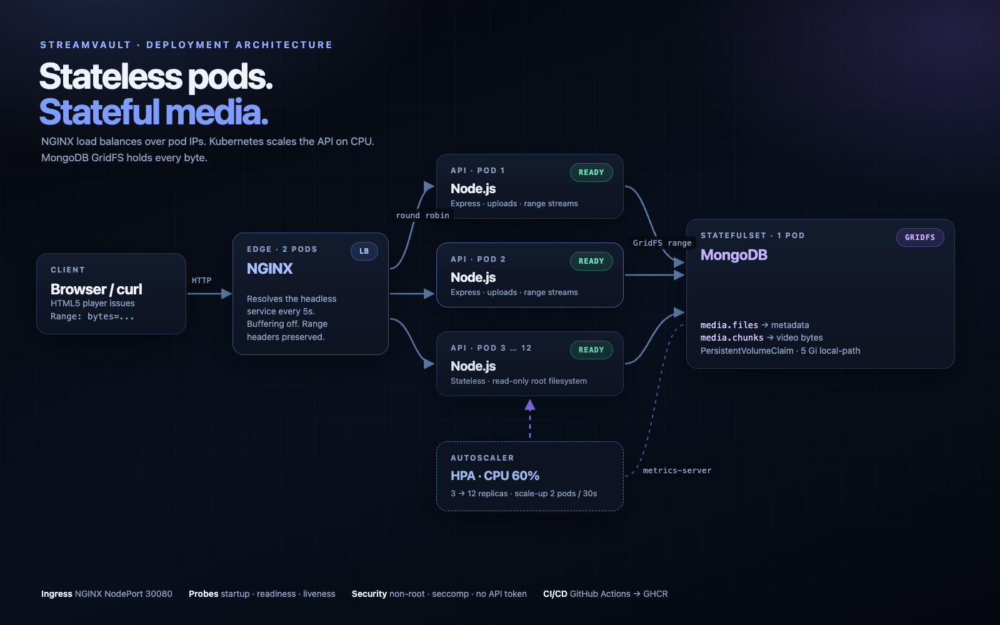
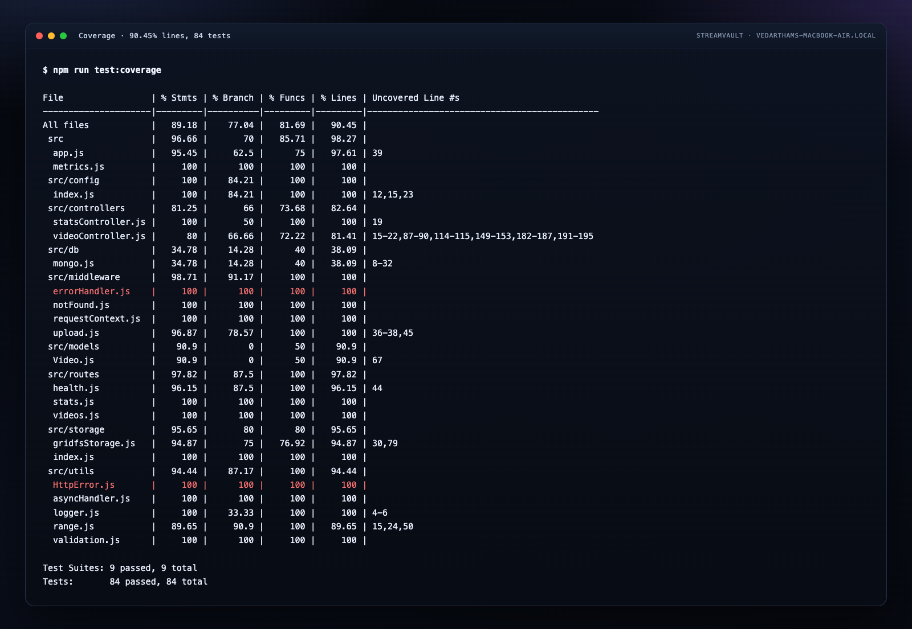

# StreamVault

**A production-shaped video streaming platform deployed with Docker, NGINX and Kubernetes.**

[](https://github.com/VedarthamSaaket/video-streaming-platform/actions/workflows/ci.yml)


StreamVault stores video metadata in MongoDB and the video bytes in MongoDB GridFS, so every API
replica is stateless. NGINX sits at the edge, load balances across the API pods, streams byte ranges
without buffering, and applies upload rate limits. Kubernetes runs three API replicas by default and
scales them horizontally with a CPU based HorizontalPodAutoscaler.



## Highlights

| Area | Implementation |
|---|---|
| Application | Node.js 22, Express, Mongoose, Zod validation, Pino structured logs |
| Media | MongoDB GridFS, HTTP Range requests, `206 Partial Content`, inline playback |
| Edge | NGINX reverse proxy, dynamic DNS discovery, range passthrough, upload rate limiting |
| Containers | Multi-stage Dockerfile, non-root user, healthcheck, `.dockerignore` |
| Local stack | Docker Compose with MongoDB, three API replicas and NGINX |
| Kubernetes | Kustomize base + local/cloud overlays, StatefulSet, Deployments, HPA, PDB, NetworkPolicy |
| Autoscaling | HPA 3 → 12 API replicas at 60% CPU, probes, rolling updates, cluster autoscaler in Terraform |
| Reliability | Startup, readiness and liveness probes, graceful shutdown, preStop hooks |
| Security | Non-root pods, read-only root filesystem, dropped capabilities, seccomp, no API token |
| Testing | 84 Jest tests, 9 suites, 90.45% line coverage, Supertest and MongoDB memory server |
| API contract | Postman collection with 20 requests and 49 assertions, run by Newman locally and in CI |
| Observability | Prometheus metrics, ServiceMonitor, alert rules, two provisioned Grafana dashboards |
| Cloud | Terraform for VPC, EKS 1.31, managed node groups, ECR, IRSA, ALB controller, cluster autoscaler |
| Delivery | GitHub Actions: test, manifests, Terraform, image scan, GHCR push, kind end to end |

## Quick start

### Prerequisites

- Node.js 22 and npm
- Docker Engine with Compose v2 (Docker Desktop, Colima or similar)
- kind, kubectl, and ffmpeg for the Kubernetes demo

### Docker Compose

```bash
cp .env.example .env
make compose-up
```

Open <http://localhost:8080>. The stack runs three API replicas behind NGINX. Upload a video and play
it; the browser will issue range requests and the API will answer with `206`.

```bash
make smoke     # health, upload, range request and load balancing
make load      # 60 second autocannon run
make compose-down
```

### Kubernetes with kind

```bash
make kind-up   # 1 control plane + 2 workers, metrics-server, local-path storage
make deploy    # build the image, load it, apply the local overlay
make seed      # upload a generated 20 second test video
make smoke     # verify everything through the NodePort
```

Open <http://localhost:30080>.

Watch autoscaling in a second terminal:

```bash
make hpa
```

### Monitoring dashboards

```bash
# kind cluster must be running
docker compose -f observability/docker-compose.yml up -d
```

- Prometheus: <http://localhost:9090>
- Grafana: <http://localhost:3001> (anonymous admin, no login)
- Application dashboard: <http://localhost:3001/d/streamvault-overview>
- Runtime dashboard: <http://localhost:3001/d/streamvault-runtime>

The Prometheus config scrapes the kind NodePort from inside the kind Docker network. Both dashboards
are provisioned from JSON, so they load without any manual import.

### API tests with Postman and Newman

```bash
bash scripts/generate-sample.sh
npm run test:api
```

The collection creates a video, exercises metadata, full and partial streaming, invalid ranges,
downloads and cleanup. It requires a running API at `http://localhost:30080`. Change
`postman/local.postman_environment.json` to use `http://localhost:8080` for Compose.

### Terraform

```bash
cd terraform
cp terraform.tfvars.example terraform.tfvars
terraform init
terraform fmt -recursive
terraform validate
```

This provisions VPC, EKS 1.31, three managed nodes, ECR, IRSA roles for the AWS Load Balancer
Controller and cluster autoscaler, plus Helm releases for both controllers and metrics-server. See
[terraform/README.md](terraform/README.md) for the plan, apply, image push and destroy workflow.

## Test results

```
Test Suites: 9 passed, 9 total
Tests:       84 passed, 84 total
Coverage:    90.45% lines, 89.18% statements
Coverage:    77.04% branches, 81.69% functions
Newman:      20 requests, 49 assertions, 0 failures
```



## API

| Method | Path | Purpose |
|---|---|---|
| GET | `/healthz` | Liveness probe |
| GET | `/readyz` | Readiness probe, checks MongoDB and GridFS |
| GET | `/health` | Detailed instance health |
| GET | `/metrics` | Prometheus metrics |
| GET | `/api/videos` | List videos (`page`, `limit`, `search`) |
| POST | `/api/videos` | Upload a video (`multipart/form-data`, field `file`) |
| GET | `/api/videos/:id` | Video metadata |
| PATCH | `/api/videos/:id` | Update title, description or uploader |
| DELETE | `/api/videos/:id` | Delete metadata and GridFS file |
| GET | `/api/videos/:id/stream` | Stream with Range support |
| GET | `/api/videos/:id/download` | Download as attachment |
| GET | `/api/stats` | Library totals and serving instance |

Full contract: [`docs/openapi.yaml`](docs/openapi.yaml). Postman collection:
[`postman/StreamVault.postman_collection.json`](postman/StreamVault.postman_collection.json).

## Environment variables

| Name | Default | Purpose |
|---|---|---|
| `PORT` | `3000` | API port |
| `MONGODB_URI` | localhost | Mongo connection string |
| `MONGODB_DB` | `streamvault` | Database name |
| `MEDIA_BUCKET` | `media` | GridFS bucket |
| `INSTANCE_ID` | hostname | Value returned in `X-Served-By` |
| `MAX_UPLOAD_BYTES` | `209715200` | Upload limit |
| `LOG_LEVEL` | `info` | Pino log level |
| `UPLOAD_RATE_MAX` | `60` | Uploads per window per IP |
| `UPLOAD_RATE_WINDOW_MS` | `900000` | Rate limit window |

## Project layout

```
src/
  app.js                 Express app, middleware chain
  server.js              HTTP server, Mongo retry, graceful shutdown
  controllers/           Upload, list, stream, stats
  middleware/            Request context, upload, errors
  models/Video.js        Mongoose schema and indexes
  routes/                Health, videos, stats
  storage/               GridFS storage driver
  utils/                 Range parser, validation, errors
public/                  Dark streaming UI
tests/                   9 suites, 84 unit and integration tests
postman/                 Postman collection, environment and guide
k8s/base/                Namespaced production-shaped manifests
k8s/overlays/local/      kind overlay (NodePort 30080, local-path)
k8s/overlays/cloud/      GHCR image, LoadBalancer, Ingress, gp3
k8s/observability/       ServiceMonitor, PrometheusRule, Grafana ConfigMap
observability/           Local Prometheus + Grafana stack and dashboards
terraform/               AWS VPC, EKS, ECR, IRSA, Helm releases
scripts/                 Cluster, deploy, smoke, load, HPA and sample scripts
docs/                    Architecture, autoscaling, runbook, demo script, API spec, evidence
```

## Screenshots

Real captures from this build:

| | |
|---|---|
| [Application UI](docs/screenshots/01-ui-kubernetes.png) | [Docker Compose stack](docs/screenshots/02-compose-ps.png) |
| [206 Range response](docs/screenshots/03-range-request.png) | [Kubernetes pods](docs/screenshots/04-k8s-pods.png) |
| [Kubernetes objects](docs/screenshots/05-k8s-objects.png) | [Unit tests](docs/screenshots/06-unit-tests.png) |
| [Integration tests](docs/screenshots/07-integration-tests.png) | [Coverage report](docs/screenshots/08-coverage.png) |
| [Newman API run](docs/screenshots/09-newman.png) | [kind smoke test](docs/screenshots/10-smoke-k8s.png) |
| [HPA 3 → 12](docs/screenshots/11-hpa-scaleup.png) | [Autocannon 68k requests](docs/screenshots/12-load-test.png) |
| [Peak CPU across 12 pods](docs/screenshots/13-top-pods.png) | [Grafana application dashboard](docs/screenshots/14-grafana-app.png) |
| [Grafana runtime dashboard](docs/screenshots/15-grafana-runtime.png) | [Terraform validation](docs/screenshots/16-terraform-validate.png) |
| [Git history](docs/screenshots/17-git-log.png) | [CI run](docs/screenshots/18-ci.png) |

## CI/CD

The GitHub Actions pipeline has five jobs:

1. **Lint and unit tests** – ESLint plus 84 Jest tests on Node 22.
2. **Validate Kubernetes manifests** – renders both overlays and the observability kustomization,
   then runs `kubeconform -strict`.
3. **Validate Terraform** – `terraform fmt -check`, `init -backend=false` and `validate`.
4. **Build and scan image** – multi-stage Docker build, Trivy scan, GHCR push on `main`.
5. **Deploy to kind and smoke test** – creates the cluster, deploys, uploads a sample, checks a 206
   range, verifies load balancing and runs the Postman collection with Newman.

## Documentation

- [Architecture](docs/architecture.md)
- [Autoscaling and load balancing](docs/autoscaling.md)
- [Operations runbook](docs/runbook.md)
- [Observability and Grafana](docs/observability.md)
- [Demo script](docs/demo-script.md)
- [Terraform infrastructure](terraform/README.md)
- [Postman guide](postman/README.md)
- [Raw evidence](docs/evidence/)

## License

MIT. The sample video is generated locally with ffmpeg and is not committed.
