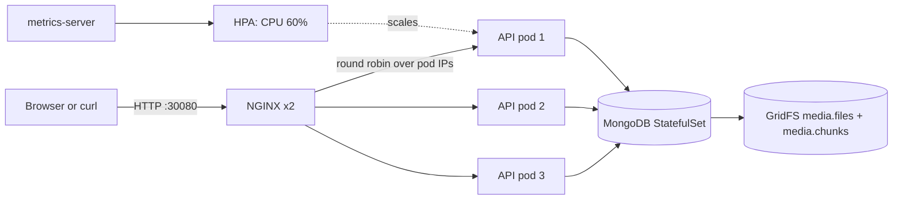

# Architecture

## Request path

## Components

### Node.js API

The API is deliberately stateless. Uploads are written to a temporary file by Multer and then
streamed into MongoDB GridFS, so no pod owns a local video directory. Download requests open a GridFS
download stream at the requested byte offset. That is what lets three or twelve replicas serve the
same video without shared storage.

Key routes are split into controllers, and validation uses Zod schemas. Every response carries
`X-Served-By` with the pod name (`INSTANCE_ID` comes from the downward API), which makes load
balancing visible in a terminal.

### MongoDB and GridFS

MongoDB runs as a StatefulSet with a PersistentVolumeClaim. One replica is enough for the lab; a
production deployment would use a managed replica set. GridFS stores the file in `media.files` and
`media.chunks` and supports range reads, which is exactly the primitive a video player needs.

The application user is created by a Kubernetes Job with `readWrite` on one database. The root
credentials are used only by that Job.

### NGINX edge

NGINX is a Deployment with two replicas. It resolves the headless service
`streamvault-app-headless.streamvault.svc.cluster.local` every five seconds, so new pods enter the
rotation without a restart. Because the service is headless, the DNS response contains pod IPs and
NGINX itself performs the round robin.

Important proxy settings:

- `proxy_buffering off` and `proxy_request_buffering off` keep streaming and uploads streaming.
- `Range` and `If-Range` are forwarded unchanged.
- `add_header X-Upstream-Addr $upstream_addr` exposes which pod answered.
- `limit_req` applies only to non-GET requests, so playback is not rate limited.

### Kubernetes

- API Deployment: 3 replicas, rolling updates with `maxUnavailable: 0`, topology spread across nodes,
  non-root, read-only root filesystem, dropped capabilities, seccomp `RuntimeDefault`.
- HPA: CPU target 60 percent, 3 to 12 replicas, scale-up limited to 2 pods or 100 percent per 30s.
- PDBs: at least 2 API pods and 1 NGINX pod remain available during drains.
- NetworkPolicy: default deny, then explicit DNS, app-to-Mongo and NGINX-to-app rules.
- Mongo: StatefulSet with a 5Gi local-path volume in the lab and gp3 in the cloud overlay.
- Probes: startup and liveness hit `/healthz`; readiness hits `/readyz`, which pings MongoDB and
  GridFS so a pod with a broken database connection never receives traffic.

### CI/CD

The GitHub Actions pipeline has four jobs:

1. `test`: ESLint plus 43 Jest tests.
2. `manifests`: `kubectl kustomize` for both overlays and `kubeconform -strict`.
3. `image`: multi-stage Docker build, Trivy scan, GHCR push on `main`.
4. `e2e`: kind cluster, image load, full deployment, sample upload, range request, load balancing check.

## Failure behaviour

| Failure | Behaviour |
|---|---|
| MongoDB unavailable | `/readyz` returns 503, pod leaves the Service, liveness still passes |
| One API pod crashes | NGINX retries the next upstream, PDB and 3 replicas keep capacity |
| Traffic spike | HPA adds pods; NGINX picks them up from DNS within 5 seconds |
| Rolling update | `maxUnavailable: 0`, new pod must pass readiness before old ones terminate |
| Node drain | PDB blocks eviction that would drop below 2 API pods |
| Broken image | Startup probe fails, rollout stops, previous ReplicaSet keeps serving |
